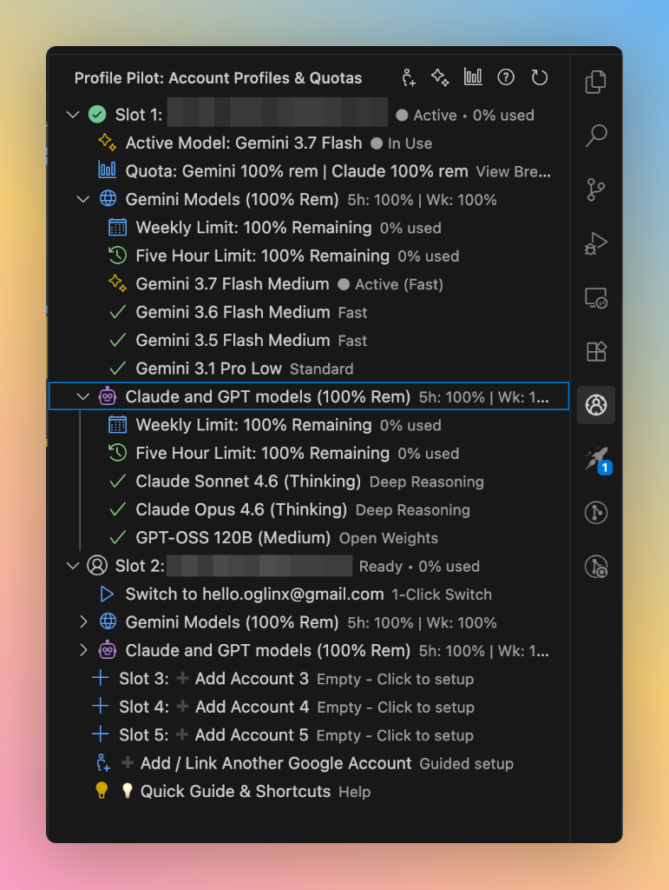

# Profile Pilot for Antigravity (macOS & Windows)

A smart, native, zero-dependency multi-account profile pilot and quota manager for **Google Antigravity IDE** and the **Antigravity Companion App** on **macOS** and **Windows**. Seamlessly switch between multiple Google accounts with 1-click to bypass Gemini and Claude rate limits without repeated log-ins.

<p align="center">
  
</p>

---

## 🚀 Key Features

- **Activity Bar Sidebar (Profile Pilot)**: Dedicated sidebar panel displaying all configured account profile slots, active session badges, live request volume, and collapsible quota pools.
- **Comprehensive Plan Tier Support (Google & Third-Party Paid Tiers)**:
  - **Auto-Detection & Verification**:
    - **Google AI Pro** (`g1-pro-tier`) & **Google AI Ultra** (`g1-ultra-tier`).
    - **Third-Party Paid Tiers**: Accounts subscribed through third-party resellers, partner organizations, or institutional licenses.
    - **Enterprise / Workspace**: Corporate Google Workspace or Teams accounts (`TEAMS_TIER`).
    - **BYOK / Custom API Tiers**: Custom endpoints or third-party AI keys.
    - **Free Tier**: Standard free Google accounts.
  - **1-Click Plan Tier Assignment (`setSlotTier`)**:
    - Right-click any account slot or use `Set Account Plan Tier...` to designate it as **Third-Party Paid Tier**, **Enterprise**, or **Google AI Pro**.
    - If a third-party paid account initially detects as standard, 1 click on *"Set as Third-Party Paid Tier"* unlocks the full suite of Pro models immediately!
  - **Smart Model Availability Indicators**:
    - Unlocked models display checkmarks (`$(check)`) or sparkles (`$(sparkle)`).
    - Locked models on free accounts show `🔒 Requires Pro/Paid Tier`.
    - Clicking a locked model offers 1-click switching to an alternate paid account or marking the current slot as Third-Party Paid.
- **Dynamic AI Model Catalog & Auto-Detection**:
  - Automatically discovers and tracks new models directly from Antigravity's unified state sync and language server binary without requiring explicit extension updates!
  - Preloaded with the latest Antigravity AI Model Suite:
    - `Gemini 3.8 Flash (High / Medium / Low)` (Fast & Deep Reasoning)
    - `Gemini 3.7 Flash (High / Medium / Low)` (Fast)
    - `Gemini 3.6 Flash (High / Medium / Low)` (Fast)
    - `Gemini 3.5 Flash (High / Medium / Low)` (Fast)
    - `Gemini 3.1 Pro (High / Low)` (Standard) & `Gemini 3.1 Flash Lite`
    - `Claude Sonnet 4.6 (Thinking)` & `Claude Opus 4.6 (Thinking)` (Deep Reasoning)
    - `Claude Sonnet 5.5` & `Claude Opus 5.5`
    - `GPT-OSS 120B (Medium)` (Open Weights)
  - Auto-detects the currently active model from Antigravity's runtime state.
- **Real-Time Auto-Updating Usage & Quotas**:
  - Automatically monitors turn and generation activity across rolling 5-hour and weekly windows.
  - Granular per-model request and turn counters visible in the sidebar and drill-down modal.
  - Capacities automatically adjust for Pro/Ultra vs Free tier account quotas.
  - Rolling quota decay automatically resets and recovers available quota after 5 hours of inactivity.
- **Background Rate Limit (429) Protection**:
  - Continuous background scanner monitors logs and conversation steps for `429` / `RESOURCE_EXHAUSTED` / `rate limit exceeded`.
  - Instantly alerts with a 1-click action to switch to an alternate account profile before interrupting work.
- **Dual-Pool Usage & Quota Drill-Down**:
  - **🌐 Gemini Models Pool**: Weekly Limit Remaining & 5-Hour Rolling Limit.
  - **🤖 Claude & GPT Models Pool**: Weekly Limit Remaining & 5-Hour Rolling Limit.
  - Interactive drill-down modal with visual progress bars.
- **Dual-App Synchronization**: Swapping accounts in Antigravity IDE automatically updates credentials in the standalone Antigravity App simultaneously.
- **Automatic Account Email Detection**: Automatically identifies and labels slots with the logged-in Google account email.
- **Guided Setup Wizard**: 3-step interactive dialog making it effortless to add and link secondary Google accounts safely without losing active work.
- **Status Bar Integration**: Visual profile buttons in the status bar with health/rate-limit color coding and 1-click switching.
- **Cross-Platform**: Zero dependencies; first-class support for **macOS (Apple Silicon & Intel)** and **Windows (10/11)**.

---

## 📦 Installation

### macOS / Linux:
Run the install script in Terminal:
```bash
./install.sh
```

### Windows (PowerShell / Command Prompt):
Run the installer script in PowerShell or Command Prompt:
```powershell
.\install.ps1
```
*(Or double-click `install.bat`)*

Then reload Antigravity IDE (`Cmd + Shift + P` / `Ctrl + Shift + P` -> **Developer: Reload Window**).

---

## 🎯 How to Use

### 1. Adding a Second Account:
1. Click **`➕ Add / Link Another Google Account`** in the sidebar (or click any empty slot like `➕ Slot 2: Add Account 2`).
2. Follow the 3-step wizard:
   - Your current account is safely preserved.
   - Sign out and log in with your 2nd Google account in the browser.
   - Click **`[Save Current Session to Slot 2]`** and give it a label (e.g. *Work* or *Secondary*).

### 2. Switching Accounts:
- Simply click any saved slot in the **Sidebar** or **Status Bar** to switch instantly.
- Both Antigravity IDE and App switch seamlessly without requiring you to re-authenticate!

### 3. Monitoring Quotas & Active Models:
- Click **`📊 Usage & Quotas`** in the sidebar to open the full drill-down dialog.
- Click **`Active Model`** or any model item to change your active AI model on the fly.

---

## ⚙️ Extension Settings

| Setting | Default | Description |
| :--- | :--- | :--- |
| `antigravityProfilePilot.maxProfiles` | `5` | Maximum number of account profile slots (1–5). |
| `antigravityProfilePilot.customModels` | `[]` | Array of custom model names or endpoints to monitor. |
| `antigravityProfilePilot.rateLimitMonitor.enabled` | `true` | Enable background log scanning for 429 quota alerts. |
| `antigravityProfilePilot.rateLimitMonitor.scanIntervalSeconds` | `15` | Log scan interval in seconds. |

---

## 📄 License
MIT License.
